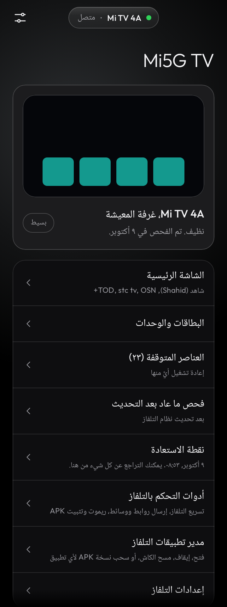
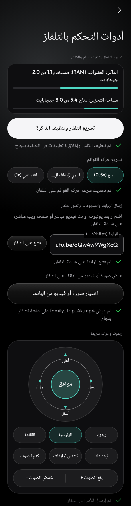
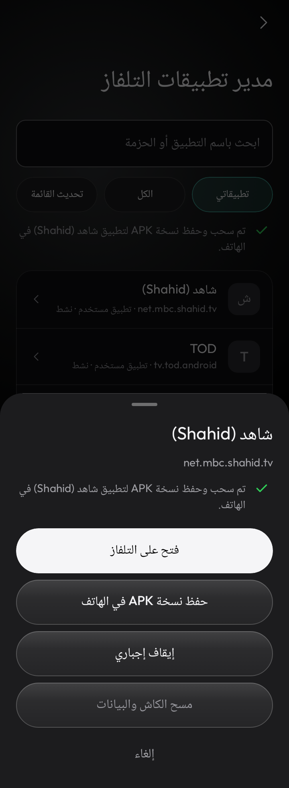
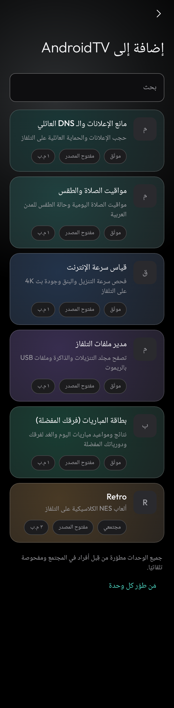
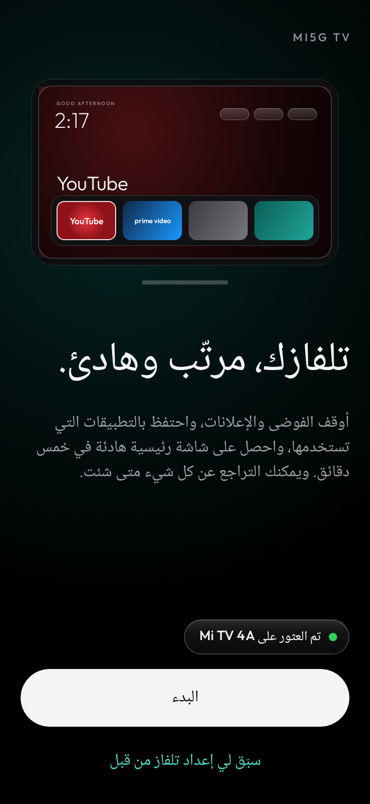
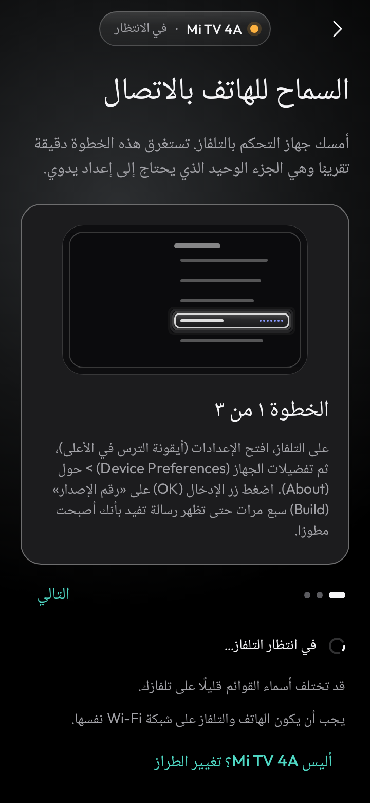
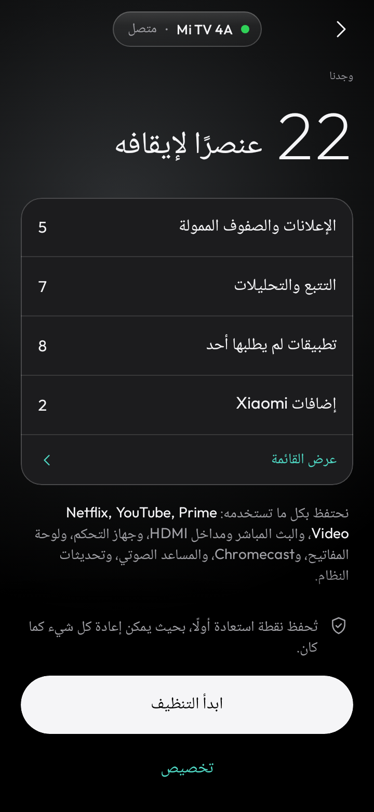

# 📺 Mi5G TV — منظف وأدوات التحكم الذكية لأجهزة Android TV و Google TV

**Mi5G TV** (`com.midroid.mi5gtv`) هو تطبيق أندرويد متكامل باللغة العربية لتنظيف وتسريع شاشات وأجهزة **Android TV** و **Google TV** و **Fire TV** عبر شبكة الـ Wi-Fi من هاتفك مباشرةً بدون روت، مع ريموت تحكم متكامل، مدير تطبيقات، وإضافات ذكية مصممة للتلفاز.

---

## 📥 التحميل المباشر (أحدث إصدار `v1.4.0`)

- **[تحميل تطبيق الهاتف Mi5G TV v1.4.0 (APK)](https://github.com/al3nkboot/mi5g-tv/releases/download/v1.4.0/Mi5G-TV-v1.4.0.apk)**
- **[صفحة جميع الإصدارات والوحدات الإضافية (Releases)](https://github.com/al3nkboot/mi5g-tv/releases/latest)**

---

## 📸 لقطات من التطبيق

| الصفحة الرئيسية وإدارة التلفاز | تسريع التلفاز والريموت وإرسال الوسائط |
| :---: | :---: |
|  |  |

| مدير تطبيقات التلفاز وسحب APK | متجر البطاقات والوحدات المدمجة |
| :---: | :---: |
|  |  |

---

## 🚀 طريقة الاستخدام خطوة بخطوة (خلال دقيقتين)

| ١. اكتشاف التلفاز تلقائياً | ٢. تفعيل الاتصال من التلفاز | ٣. مراجعة الخطة وبدء التنظيف |
| :---: | :---: | :---: |
|  |  |  |

1. **تجهيز التلفاز (مرة واحدة فقط):**
   - تأكد أن هاتفك والتلفاز متصلان على **نفس شبكة الـ Wi-Fi**.
   - من التلفاز افتح: **الإعدادات > تفضيلات الجهاز (أو النظام) > حول (About)**، واضغط زر **موافق (OK)** على **رقم الإصدار (Build)** 7 مرات متتالية حتى يتفعل وضع المطور.
   - ارجع خطوة للخلف وادخل **خيارات المطور (Developer options)** وفعّل **تصحيح أخطاء USB (USB debugging)** (أو تصحيح الأخطاء اللاسلكي/عبر الشبكة).
2. **الربط من الجوال:**
   - افتح تطبيق **Mi5G TV** على جوالك، وسيعثر على تلفازك تلقائياً في الشبكة (أو أدخل عنوان الـ IP يدوياً).
   - ستظهر نافذة تأكيد على شاشة التلفاز؛ اختر **السماح دائماً من هذا الكمبيوتر (Always allow)** واضغط **موافق**.
3. **التنظيف وتثبيت الشاشة الرئيسية:**
   - يعرض لك التطبيق عدد عناصر الإعلانات والتتبع التي وجدها مع بقاء جميع تطبيقاتك الأساسية محمية.
   - اضغط **ابدأ التنظيف**، وسيحفظ التطبيق **نقطة استعادة تلقائية** أولاً ثم ينظف النظام ويثبّت الشاشة الرئيسية الهادئة.
4. **استخدام الأدوات الذكية والإضافات:**
   - من شاشة إدارة التلفاز يمكنك الدخول إلى **أدوات التحكم بالتلفاز** (لتسريع الرام وحركة القوائم، الريموت الدائري، وإرسال الروابط والصور والفيديو)، أو **مدير تطبيقات التلفاز** (لإدارة التطبيقات وسحب نسخ `APK` للهاتف)، أو **البطاقات والوحدات** (لتثبيت مانع الإعلانات ومواقيت الصلاة وقياس السرعة ومدير الملفات وبطاقة المباريات).

---

## ✨ أبرز المميزات

### 1. 🧹 تنظيف التلفاز وإيقاف الإعلانات بأمان
- إيقاف تطبيقات الإعلانات والتتبع والعروض الترويجية المدمجة في النظام بدون حذف أي بيانات، مع دعم أكثر من **132 ملف تعريف رسمي** لمختلف ماركات الشاشات (Sony, TCL, Xiaomi Mi TV, Hisense, Philips, Thomson/Kodak, Chromecast وغيرها).
- **نقطة استعادة تلقائية:** يحفظ التطبيق نسخة احتياطية كاملة قبل أي تعديل، لتتمكن من استرجاع حالة المصنع بضغطة زر واحدة متى شئت.

### 2. 🏠 شاشة رئيسية نظيفة ودعم منصات البث العربية
- تثبيت شاشة رئيسية خفيفة وسريعة خالية من الإعلانات مع شريط تطبيقات قابل للتخصيص.
- تعرف تلقائي وحماية كاملة لتطبيقات البث العربية والعالمية (**شاهد Shahid، TOD، stc tv، STARZPLAY، OSN+، WATCH IT، Yango Play، الأولى، أوان، أنغامي، beIN CONNECT، YouTube، Netflix**).

### 3. ⚡ تسريع التلفاز وتنظيف الذاكرة (Speed Boost)
- عرض استهلاك الذاكرة العشوائية (`RAM`) والمساحة التخزينية للتلفاز بشكل لحظي.
- تنظيف الملفات المؤقتة (`Cache`) وإغلاق التطبيقات العالقة في الخلفية بضغطة واحدة.
- التحكم بسرعة حركة القوائم في التلفاز (`سريع 0.5x`، `فوري 0x`، أو `افتراضي 1x`) لزيادة سلاسة التنقل بالريموت.

### 4. 🎮 ريموت تحكم متكامل وإرسال الروابط والوسائط (Quick Cast)
- **ريموت دائري واقعي (`D-Pad`):** تحكم كامل بالاتجاهات، الصوت، كتم الصوت، الطاقة، الإعدادات، وإرسال النصوص الطويلة من كيبورد الجوال إلى التلفاز فوراً.
- **تصوير شاشة التلفاز:** التقاط صورة فورية لشاشة التلفاز وحفظها أو مشاركتها من الهاتف.
- **إرسال الروابط والصور والفيديو:** فتح أي رابط على التلفاز أو عرض الصور والفيديوهات من جوالك على شاشة التلفاز مباشرة، مع إمكانية تثبيت ملفات `APK` عن بُعد.

### 5. 📦 مدير تطبيقات التلفاز الكامل (TV App Manager)
- استعراض جميع تطبيقات التلفاز مع البحث والفلترة (`تطبيقاتي` / `الكل`).
- فتح أي تطبيق على التلفاز، إيقافه إجبارياً، مسح الكاش والبيانات، أو إلغاء تثبيته.
- **سحب نسخة احتياطية (`Pull APK`):** استخراج ملف `APK` لأي تطبيق مثبت على التلفاز وحفظه مباشرة في ذاكرة هاتفك.

### 6. 🧩 وحدات وتطبيقات عربية مدمجة للتلفاز (5 Modules)
تثبيت بضغطة زر واحدة من الهاتف بدون إنترنت:
- **مانع الإعلانات والـ DNS العائلي (`AdGuard DNS`):** حجب الإعلانات والحماية العائلية على التلفاز.
- **مواقيت الصلاة والطقس (`Prayer & Weather`):** مواقيت الصلاة اليومية وحالة الطقس للمدن العربية.
- **قياس سرعة الإنترنت (`TV Speedtest`):** فحص سرعة التنزيل وزمن الاستجابة (`Ping`) وجودة بث `4K`.
- **مدير ملفات التلفاز (`TV File Manager`):** تصفح مجلد التنزيلات والذاكرة وملفات `USB` بالريموت.
- **بطاقة المباريات — فرقك المفضلة (`مباريات اليوم` / `tv-matches`):** نتائج ومواعيد مباريات اليوم والغد بالتوقيت المحلي مع فلترة الفرق والدوريات العربية والأوروبية المفضلة بالريموت.

---

## 🔒 الخصوصية والأمان
- يتصل التطبيق بتلفازك محلياً عبر شبكة الـ Wi-Fi فقط (`ADB over Wi-Fi`).
- لا يجمع أي بيانات شخصية، ولا يحتوي على أي إعلانات أو أدوات تتبع.

---

## 💙 دعم استمرارية تطوير التطبيق (Support Development)
إذا أعجبك التطبيق واستفدت منه، يمكنك دعم المطور **أحمد الأسد (`@midroid5G`)** للمساهمة في استمرار تطوير التطبيق وتحديثه مجاناً وبدون إعلانات:
- **PayPal:** [**paypal.me/Midroid5G**](https://paypal.me/Midroid5G) (`@Midroid5G`)
- **حساب X (تويتر):** [**@midroid5G**](https://x.com/midroid5G)

---

## 🙏 شكر وتقدير (Credits)
هذا التطبيق مبني على المشروعين المفتوحي المصدر بترخيص MIT:
- **[Clean Your TV (phone app)](https://github.com/udhaykumarbala/cleanyourtv-app)** من تطوير **udhaykumarbala** والمساهمين.
- **[Clean Your TV](https://github.com/Gathin23/cleanyourtv)** (مشروع الشاشة الرئيسية وقوائم التنظيف المجتمعية) من تطوير **Gathin** والمساهمين.

---

# Mi5G TV (English Overview)

**Mi5G TV** (`com.midroid.mi5gtv`) is an Arabic-first Android TV & Google TV cleaner, remote toolkit, and app manager over Wi-Fi (ADB).

- **Debloat & Clean Home Screen:** Safely disables vendor bloatware and ad rows across 132+ verified TV profiles with a one-tap restore point.
- **Speed Boost & Quick Cast:** Live RAM/storage monitor, cache trim + background force-stop, animation speed toggle (`0.5x` / `0x` / `1x`), URL/photo/video casting, and remote APK installer.
- **Full TV App Manager:** Launch, Force Stop, Clear Cache/Data, Uninstall, and pull APK backups from TV to phone.
- **5 Bundled TV Modules:** Built-in AdGuard DNS switcher, Prayer Times & Weather, TV Speedtest, TV File Manager, and Today's Matches (`tv-matches`) with full Android TV Leanback banner support.

- **Support Development:** [PayPal (@Midroid5G)](https://paypal.me/Midroid5G) · [@midroid5G on X](https://x.com/midroid5G)

See [LICENSE](LICENSE) and [THIRD-PARTY-NOTICES](THIRD-PARTY-NOTICES) for full license texts.
